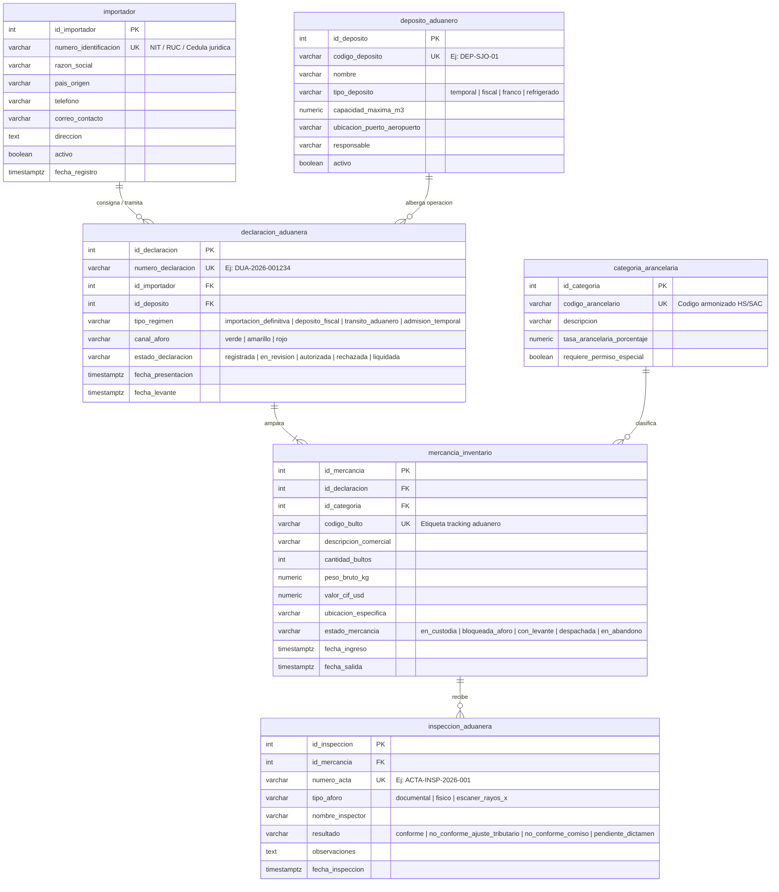

# Fase 1: Modelo Entidad-Relación (DER) - Sistema de Inventario Aduanero

## 1. Contexto y Propósito del Sistema
El presente sistema modela el control de inventario de mercancías bajo régimen aduanero y custodia fiscal en depósitos aduaneros, permitiendo la trazabilidad desde el arribo y declaración aduanera (DUA) de las mercancías, su ubicación física en bodega, su estado fiscal (en custodia, retenida, levante autorizado) y las inspecciones físicas o documentales (aforos) realizadas por las autoridades aduaneras.

---

## 2. Diagrama Entidad-Relación (Mermaid ERD)

---

## 3. Diccionario de Datos y Reglas de Negocio

### 3.1. Tablas Fuertes / Padres (Sin dependencias foráneas directas)
1. **`importador`**: Almacena las empresas o personas jurídicas responsables legales de la carga ingresada al país.
   - Restricciones: `numero_identificacion` es `UNIQUE` y `NOT NULL`. Validación de formato de correo en `correo_contacto`.
2. **`deposito_aduanero`**: Almacenes autorizados por la Dirección General de Aduanas para la custodia de mercancías.
   - Restricciones: `capacidad_maxima_m3 > 0`. `tipo_deposito` restringido a valores válidos aduaneros.
3. **`categoria_arancelaria`**: Catálogo oficial de partidas arancelarias según el Sistema Arancelario Centroamericano (SAC) o Sistema Armonizado (HS).
   - Restricciones: `tasa_arancelaria_porcentaje BETWEEN 0 AND 100`.

### 3.2. Tablas Hijas y Transaccionales
4. **`declaracion_aduanera`**: Trámite de declaración que ampara la importación de un conjunto de mercancías.
   - Dependencias: Llaves foráneas obligatorias hacia `importador` y `deposito_aduanero`.
   - Restricciones: `canal_aforo` (verde, amarillo, rojo). `fecha_levante >= fecha_presentacion` cuando exista.
5. **`mercancia_inventario`**: Registro físico de cada lote, bulto o contenedor almacenado físicamente en el depósito aduanero.
   - Dependencias: Llaves foráneas hacia `declaracion_aduanera` y `categoria_arancelaria`.
   - Restricciones: `cantidad_bultos > 0`, `peso_bruto_kg > 0`, `valor_cif_usd >= 0`. `fecha_salida >= fecha_ingreso`. Estados finitos de custodia.
6. **`inspeccion_aduanera`**: Registro de control aduanero y actuaciones fiscales sobre mercancías seleccionadas por canal o criterio de riesgo.
   - Dependencias: Llave foránea hacia `mercancia_inventario`.
   - Restricciones: `numero_acta` único. Tipo de aforo y resultado tipificados bajo `CHECK`.

---

## 4. Orden de Creación y Dependencias (DDL)
1. `importador` (Padre)
2. `deposito_aduanero` (Padre)
3. `categoria_arancelaria` (Padre)
4. `declaracion_aduanera` (Hija de importador y deposito_aduanero)
5. `mercancia_inventario` (Hija de declaracion_aduanera y categoria_arancelaria)
6. `inspeccion_aduanera` (Hija de mercancia_inventario)
