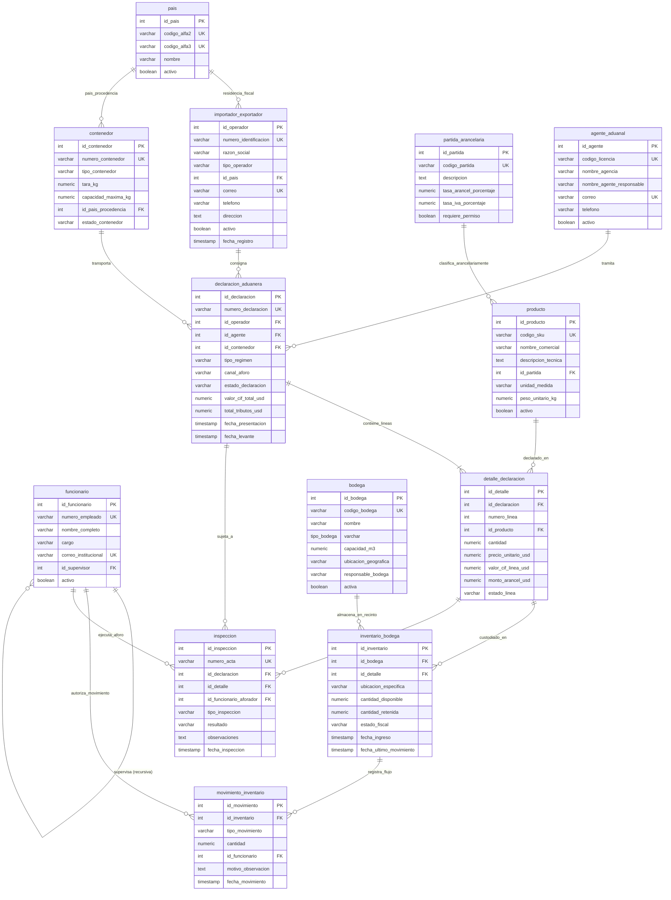

# Fase 1: Modelo Entidad-Relación (DER) - Sistema de Inventario Aduanero

**Proyecto:** Sistema de Inventario Aduanero y Custodia Fiscal  
**Estudiante:** Bianca Robles Hurtado  
**Gestor:** PostgreSQL 15 / 16 / 17  
**Normalización:** Tercera Forma Normal (3FN)  
**Total de Entidades:** 13 entidades normalizadas  

---

## 1. Contexto y Propósito del Sistema
El presente modelo relacional gestiona la custodia física y fiscalización de mercancías en recintos aduaneros y bodegas autorizadas. Proporciona trazabilidad completa desde la declaración de importación/exportación (DUA), los contenedores intermodales, los bultos/líneas de mercancía en inventario, hasta los movimientos de inventario, inspecciones físicas/documentales y la jerarquía de fiscalización entre funcionarios aduaneros.

---

## 2. Código DBML (Listo para dbdiagram.io)

> [!TIP]
> Copia el siguiente bloque de código y pégalo directamente en [dbdiagram.io](https://dbdiagram.io/) para visualizar y exportar el diagrama DER en **PNG** o **PDF**.

```dbml
// ============================================================================
// SISTEMA DE INVENTARIO ADUANERO - ESQUEMA DBML (13 TABLAS EN 3FN)
// ============================================================================

Table pais {
  id_pais int [pk, increment]
  codigo_alfa2 varchar(2) [unique, not null, note: 'ISO 3166-1 alpha-2']
  codigo_alfa3 varchar(3) [unique, not null, note: 'ISO 3166-1 alpha-3']
  nombre varchar(100) [not null]
  activo boolean [not null, default: true]
}

Table importador_exportador {
  id_operador int [pk, increment]
  numero_identificacion varchar(25) [unique, not null, note: 'RUT / Cedula Juridica']
  razon_social varchar(150) [not null]
  tipo_operador varchar(20) [not null, note: 'importador | exportador | ambos']
  id_pais int [not null, ref: > pais.id_pais]
  correo varchar(100) [unique, not null]
  telefono varchar(25) [not null]
  direccion text [not null]
  activo boolean [not null, default: true]
  fecha_registro timestamp [not null, default: `CURRENT_TIMESTAMP`]
}

Table agente_aduanal {
  id_agente int [pk, increment]
  codigo_licencia varchar(25) [unique, not null]
  nombre_agencia varchar(120) [not null]
  nombre_agente_responsable varchar(100) [not null]
  correo varchar(100) [unique, not null]
  telefono varchar(25) [not null]
  activo boolean [not null, default: true]
}

Table funcionario {
  id_funcionario int [pk, increment]
  numero_empleado varchar(20) [unique, not null]
  nombre_completo varchar(120) [not null]
  cargo varchar(80) [not null]
  correo_institucional varchar(100) [unique, not null]
  id_supervisor int [null, ref: > funcionario.id_funcionario, note: 'Relacion recursiva 1:N']
  activo boolean [not null, default: true]
}

Table partida_arancelaria {
  id_partida int [pk, increment]
  codigo_partida varchar(20) [unique, not null, note: 'Codigo SAC/HS 10 digitos']
  descripcion text [not null]
  tasa_arancel_porcentaje numeric(5,2) [not null]
  tasa_iva_porcentaje numeric(5,2) [not null]
  requiere_permiso boolean [not null, default: false]
}

Table producto {
  id_producto int [pk, increment]
  codigo_sku varchar(30) [unique, not null]
  nombre_comercial varchar(120) [not null]
  descripcion_tecnica text [not null]
  id_partida int [not null, ref: > partida_arancelaria.id_partida]
  unidad_medida varchar(20) [not null]
  peso_unitario_kg numeric(10,3) [not null]
  activo boolean [not null, default: true]
}

Table contenedor {
  id_contenedor int [pk, increment]
  numero_contenedor varchar(15) [unique, not null, note: 'Norma ISO 6346']
  tipo_contenedor varchar(20) [not null]
  tara_kg numeric(8,2) [not null]
  capacidad_maxima_kg numeric(10,2) [not null]
  id_pais_procedencia int [not null, ref: > pais.id_pais]
  estado_contenedor varchar(25) [not null, default: 'patio_aduanero']
}

Table bodega {
  id_bodega int [pk, increment]
  codigo_bodega varchar(20) [unique, not null]
  nombre varchar(100) [not null]
  tipo_bodega varchar(30) [not null]
  capacidad_m3 numeric(10,2) [not null]
  ubicacion_geografica varchar(120) [not null]
  responsable_bodega varchar(100) [not null]
  activa boolean [not null, default: true]
}

Table declaracion_aduanera {
  id_declaracion int [pk, increment]
  numero_declaracion varchar(30) [unique, not null, note: 'Numero DUA oficial']
  id_operador int [not null, ref: > importador_exportador.id_operador]
  id_agente int [not null, ref: > agente_aduanal.id_agente]
  id_contenedor int [null, ref: > contenedor.id_contenedor]
  tipo_regimen varchar(30) [not null]
  canal_aforo varchar(15) [not null, note: 'verde | amarillo | rojo']
  estado_declaracion varchar(25) [not null]
  valor_cif_total_usd numeric(14,2) [not null]
  total_tributos_usd numeric(14,2) [not null]
  fecha_presentacion timestamp [not null]
  fecha_levante timestamp [null]
}

Table detalle_declaracion {
  id_detalle int [pk, increment]
  id_declaracion int [not null, ref: > declaracion_aduanera.id_declaracion]
  numero_linea int [not null]
  id_producto int [not null, ref: > producto.id_producto]
  cantidad numeric(12,2) [not null]
  precio_unitario_usd numeric(12,2) [not null]
  valor_cif_linea_usd numeric(14,2) [not null]
  monto_arancel_usd numeric(14,2) [not null]
  estado_linea varchar(20) [not null, default: 'declarada']
}

Table inventario_bodega {
  id_inventario int [pk, increment]
  id_bodega int [not null, ref: > bodega.id_bodega]
  id_detalle int [not null, ref: > detalle_declaracion.id_detalle]
  ubicacion_especifica varchar(50) [not null]
  cantidad_disponible numeric(12,2) [not null]
  cantidad_retenida numeric(12,2) [not null, default: 0.00]
  estado_fiscal varchar(25) [not null, default: 'en_bodega']
  fecha_ingreso timestamp [not null, default: `CURRENT_TIMESTAMP`]
  fecha_ultimo_movimiento timestamp [not null, default: `CURRENT_TIMESTAMP`]
}

Table movimiento_inventario {
  id_movimiento int [pk, increment]
  id_inventario int [not null, ref: > inventario_bodega.id_inventario]
  tipo_movimiento varchar(25) [not null]
  cantidad numeric(12,2) [not null]
  id_funcionario int [not null, ref: > funcionario.id_funcionario]
  motivo_observacion text [not null]
  fecha_movimiento timestamp [not null, default: `CURRENT_TIMESTAMP`]
}

Table inspeccion {
  id_inspeccion int [pk, increment]
  numero_acta varchar(30) [unique, not null]
  id_declaracion int [not null, ref: > declaracion_aduanera.id_declaracion]
  id_detalle int [null, ref: > detalle_declaracion.id_detalle]
  id_funcionario_aforador int [not null, ref: > funcionario.id_funcionario]
  tipo_inspeccion varchar(25) [not null]
  resultado varchar(30) [not null]
  observaciones text [not null]
  fecha_inspeccion timestamp [not null, default: `CURRENT_TIMESTAMP`]
}
```

---

## 3. Diagrama Entidad-Relación (Mermaid ERD)


